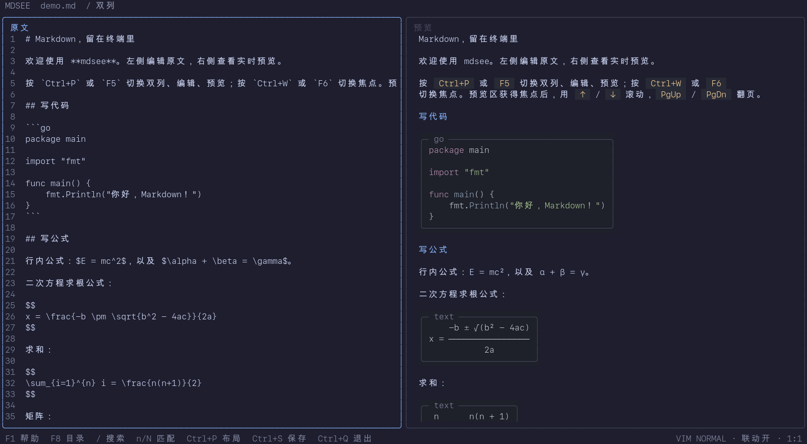

# mdsee

English · [简体中文](README.zh-CN.md)

**Read, edit, and preview Markdown in your terminal.**

mdsee is a keyboard-driven Markdown reader and editor for READMEs, project notes, and design documents. It opens in preview mode, with a table of contents and search to help you navigate. Switch to split view to edit the source alongside its rendered preview.



[Quick start](#quick-start) · [Keyboard controls](#keyboard-controls) · [User guide (中文)](docs/USAGE.md)

## Features

- **Markdown rendering** with headings, lists, tables, task lists, syntax highlighting, and Unicode layout for LaTeX math.
- **Editing and live preview** with preview, split, and editor layouts, linked scrolling, Chinese text input, multiline paste, undo, and redo.
- **Keyboard navigation** with core Vim bindings, a filterable table of contents, literal text search, and match navigation.
- **Images and diagrams** with local and HTTP/HTTPS images, Mermaid image rendering, text fallback, and a persistent diagram cache.
- **Multiple files** with per-file cursor positions, scroll positions, and edit history, plus Markdown file discovery within a project.
- **Themes** with dark, light, and ASCII styles. Code blocks have language labels, borders, and a distinct background.
- **Save checks** that detect external file changes before saving and prompt about unsaved changes across all open files when quitting.

## Quick start

### Build and install

Requires **Go 1.25.8 or later**. Clone the repository and enter its directory.

```sh
git clone https://github.com/watercolor/mdsee.git
cd mdsee
```

On macOS or Linux, build and open the demo.

```sh
go build -o bin/mdsee ./cmd/mdsee
./bin/mdsee examples/demo.md
```

On Windows, use PowerShell.

```powershell
go build -o bin/mdsee.exe ./cmd/mdsee
.\bin\mdsee.exe examples\demo.md
```

To use the `mdsee` command directly, install it from the repository directory.

```sh
go install ./cmd/mdsee
```

Go installs the executable into `GOBIN`, or `GOPATH/bin` by default. Add that directory to your `PATH` to run the commands below.

### Open a document

```sh
# Read a document
mdsee README.md

# Edit alongside the preview
mdsee --mode split notes.md

# Use ordinary editing to type directly
mdsee --mode split --vim=false notes.md

# Open multiple files
mdsee README.md docs/USAGE.md

# Use the light theme
mdsee --theme light README.md
```

The defaults are preview layout, dark theme, and Vim Normal mode. A missing file opens as an empty buffer and is created on the first save. Its parent directory must already exist. With no path argument, mdsee opens `untitled.md` in the current directory.

The interface currently uses Chinese labels. The guides and example documents linked below are also in Chinese.

## Keyboard controls

### Reading and navigation

These bindings apply when the preview has focus.

| Key | Action |
| --- | --- |
| `↑` / `↓`, `j` / `k` | Scroll up / down |
| `Space` / `PgDn`, `PgUp` | Page down / up |
| `/`, type a query, then `Enter` | Search and jump to a match |
| `n` / `N` | Next / previous match |
| `o` | Open the table of contents, select with `j/k`, jump with `Enter` |
| `Tab` / `Shift+Tab` | Next / previous file |
| `q` | Quit, with a prompt for unsaved changes |

In the table of contents, press `/` to filter headings and `Esc` to return. Text search uses case-sensitive literal matching.

### Editing and layouts

From the default preview, press `Ctrl+P` to enter split view with the source editor focused. In Vim mode, press `i` to type, `Esc` to return to Normal mode, and `Ctrl+S` to save.

| Key | Action |
| --- | --- |
| `Ctrl+P` / `F5` | Cycle through split, editor, and preview layouts |
| `Ctrl+W` / `F6` | Switch focus between source and preview in split view |
| `Ctrl+S` / `F2` | Save the current file |
| `F4` | Toggle Vim bindings / ordinary editing |
| `F7` | Toggle linked scrolling |
| `F9` / `F10` | Find project documents / list open files |
| `Ctrl+Q` | Request to quit from any panel |
| `F1` | Open the full keyboard reference |

At the quit prompt, `S` saves all files and exits, `D` discards changes and exits, and `Esc` returns. The full Vim bindings, file switching, and scrolling behavior are covered in the user guide. [User guide (中文)](docs/USAGE.md)

## Images and Mermaid

Images can use local paths or HTTP/HTTPS URLs. Supported formats are PNG, JPEG, and the first frame of a GIF. Relative paths resolve from the Markdown file's directory.

```markdown

```

mdsee automatically chooses original-image display or colored character blocks based on terminal capabilities. Original-image display uses Kitty Unicode placeholders, with automatic detection for stable iTerm2 releases from 3.7.3 onward. Inside tmux, images use colored character blocks. Select a mode with `--images auto|kitty|blocks|off`.

With Mermaid CLI installed locally, mdsee renders Mermaid code blocks to images in the background, refreshes the preview when they are ready, and reuses cached images across launches.

```sh
npm install -g @mermaid-js/mermaid-cli
mmdc --version
mdsee examples/mermaid.md
```

Image rendering with `mmdc` requires Node.js and a compatible browser runtime. The guides cover text fallback, browser setup, image compatibility, and cache settings. [User guide (中文)](docs/USAGE.md#mermaid-渲染) · [Mermaid CLI documentation](https://github.com/mermaid-js/mermaid-cli)

## Print a text preview

Use `--print` to write rendered text to a file or pipe. Set the output width with `--width`.

```sh
mdsee --print --width 100 README.md > preview.txt
```

File and pipe output strips ANSI colors, represents images as text descriptions, and renders Mermaid as text. Run `mdsee --help` for all options.

## Examples and documentation

| Topic | Document |
| --- | --- |
| Editing, code, and math | [examples/demo.md](examples/demo.md) |
| Heading levels and colors | [examples/headings.md](examples/headings.md) |
| Local and remote images | [examples/images.md](examples/images.md) |
| Mermaid diagrams | [examples/mermaid.md](examples/mermaid.md) |
| Full controls, options, and compatibility | [User guide (中文)](docs/USAGE.md) |
| Source layout, builds, and tests | [Development guide (中文)](docs/DEVELOPMENT.md) |
| Planned features | [Feature backlog (中文)](docs/FEATURE_BACKLOG.md) |

## Acknowledgments

mdsee uses Bubble Tea, Bubbles, Glamour, Chroma, termtex, and mermaidtext for terminal interaction and content rendering. Its reading interactions and colors draw on projects including Glow and mdterm. Dependencies and references are listed in the development guide. [Development guide (中文)](docs/DEVELOPMENT.md#技术依赖与参考)
