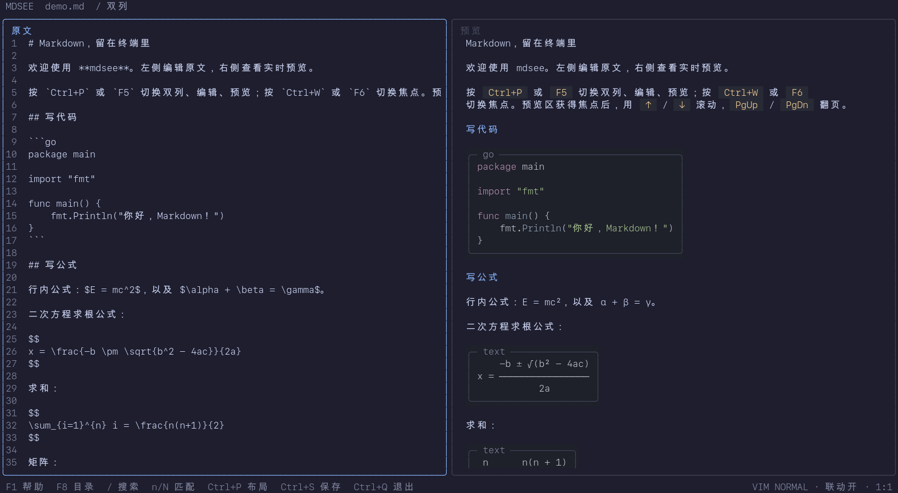

# mdsee

[English](README.md) · 简体中文

**在终端里阅读、编辑和预览 Markdown。**

mdsee 是一个键盘驱动的 Markdown 阅读器与编辑器，适合查看 README、项目笔记和设计文档。默认进入阅读预览，用目录和搜索定位内容，切换分屏后即可对照预览修改原文。



[快速开始](#快速开始) · [常用操作](#常用操作) · [完整使用指南](docs/USAGE.md)

## 功能

- **阅读与排版**　标题、列表、表格、任务列表、代码高亮，以及 LaTeX 公式的 Unicode 字符排版。
- **编辑与预览**　预览、分屏、编辑三种布局，双向关联滚动，支持中文、多行粘贴、撤销和重做。
- **键盘导航**　Vim 核心操作、文档目录、标题过滤、全文字面搜索和匹配跳转。
- **图片与图表**　本地与 HTTP/HTTPS 图片预览，Mermaid 图片渲染、字符回退和持久化缓存。
- **多文件工作**　同时打开多个文件，切换时保留光标、滚动位置和编辑记录，也可从项目目录发现 Markdown 文件。
- **深浅主题**　深色、浅色和 ASCII 样式，代码块带语言标签、边框与独立底色。
- **保存检查**　保存前检测外部修改，退出时检查全部缓冲区的未保存内容。

## 快速开始

### 构建运行

需要 **Go 1.25.8 或更新版本**。克隆本仓库并进入项目目录。

```sh
git clone https://github.com/watercolor/mdsee.git
cd mdsee
```

macOS / Linux 使用以下命令构建并打开示例。

```sh
go build -o bin/mdsee ./cmd/mdsee
./bin/mdsee examples/demo.md
```

Windows PowerShell 使用以下命令。

```powershell
go build -o bin/mdsee.exe ./cmd/mdsee
.\bin\mdsee.exe examples\demo.md
```

希望直接使用 `mdsee` 命令时，可在项目目录执行安装。

```sh
go install ./cmd/mdsee
```

命令安装到 `GOBIN` 指定的位置，默认采用 `GOPATH` 下的 `bin` 目录。将对应目录加入 `PATH` 后，即可使用下文的 `mdsee` 命令。

### 打开文档

```sh
# 阅读文档
mdsee README.md

# 分屏编辑与预览
mdsee --mode split notes.md

# 使用普通编辑方式，直接输入文字
mdsee --mode split --vim=false notes.md

# 同时打开多个文件
mdsee README.md docs/USAGE.md

# 使用浅色主题
mdsee --theme light README.md
```

默认使用预览布局、深色主题和 Vim Normal 模式。文件路径不存在时会打开空白缓冲区，第一次保存时创建文件，父目录需要已经存在。不传文件路径时打开当前目录的 `untitled.md`。

## 常用操作

### 阅读与定位

以下操作在预览区获得焦点时使用。

| 按键 | 操作 |
| --- | --- |
| `↑` / `↓`、`j` / `k` | 上下滚动 |
| `Space` / `PgDn`、`PgUp` | 向下 / 向上翻页 |
| `/` → 输入文字 → `Enter` | 搜索并跳转 |
| `n` / `N` | 下一个 / 上一个匹配 |
| `o` | 打开目录，`j/k` 选择，`Enter` 跳转 |
| `Tab` / `Shift+Tab` | 切换下一个 / 上一个文件 |
| `q` | 退出，未保存时先提示 |

目录中可按 `/` 过滤标题，按 `Esc` 返回。搜索采用区分大小写的字面匹配。

### 编辑与窗口

从默认预览界面按 `Ctrl+P` 进入分屏，焦点会切到原文。Vim 模式下按 `i` 输入文字，按 `Esc` 返回 Normal，再用 `Ctrl+S` 保存。

| 按键 | 操作 |
| --- | --- |
| `Ctrl+P` / `F5` | 循环切换分屏、编辑、预览布局 |
| `Ctrl+W` / `F6` | 分屏下切换原文与预览焦点 |
| `Ctrl+S` / `F2` | 保存当前文件 |
| `F4` | 切换 Vim 与普通编辑方式 |
| `F7` | 开关关联滚动 |
| `F9` / `F10` | 发现项目文档 / 查看已打开文件 |
| `Ctrl+Q` | 从任意面板发起退出 |
| `F1` | 查看完整快捷键帮助 |

退出提示中，`S` 保存全部文件后退出，`D` 放弃修改后退出，`Esc` 返回。完整 Vim 操作、文件切换和滚动说明见 [使用指南](docs/USAGE.md)。

## 图片与 Mermaid

图片支持本地文件与 HTTP/HTTPS 地址，格式包括 PNG、JPEG 和 GIF 首帧。相对路径以 Markdown 文件所在目录为基准。

```markdown

```

默认根据终端能力选择原图或彩色字符预览。原图显示使用 Kitty Unicode 图片占位符，自动检测包括 iTerm2 3.7.3 及以上正式版；tmux 中使用彩色字符预览。可通过 `--images auto|kitty|blocks|off` 选择显示方式。

安装本机 Mermaid CLI 后，mdsee 会在后台将 Mermaid 代码块生成为图片，自动刷新预览，并在重复打开时复用缓存。

```sh
npm install -g @mermaid-js/mermaid-cli
mmdc --version
mdsee examples/mermaid.md
```

`mmdc` 图片渲染需要 Node.js 和匹配的浏览器运行环境。Mermaid 的字符回退范围、浏览器安装、图片兼容性和缓存设置见 [使用指南](docs/USAGE.md#mermaid-渲染) 与 [Mermaid CLI 文档](https://github.com/mermaid-js/mermaid-cli)。

## 输出文本预览

使用 `--print` 将排版结果写入文件或管道，`--width` 控制输出宽度。

```sh
mdsee --print --width 100 README.md > preview.txt
```

输出到文件或管道时移除 ANSI 颜色，图片以文字说明呈现，Mermaid 使用字符渲染。全部选项可通过 `mdsee --help` 查看。

## 示例与文档

| 内容 | 入口 |
| --- | --- |
| 编辑、代码与公式示例 | [examples/demo.md](examples/demo.md) |
| 标题层级与配色 | [examples/headings.md](examples/headings.md) |
| 本地与网络图片 | [examples/images.md](examples/images.md) |
| Mermaid 图表示例 | [examples/mermaid.md](examples/mermaid.md) |
| 完整操作、参数与兼容性 | [使用指南](docs/USAGE.md) |
| 源码结构、构建与测试 | [开发指南](docs/DEVELOPMENT.md) |
| 后续功能规划 | [功能待办](docs/FEATURE_BACKLOG.md) |

## 致谢

mdsee 使用 Bubble Tea、Bubbles、Glamour、Chroma、termtex 和 mermaidtext 构建终端交互与内容渲染，阅读交互与配色参考了 Glow、mdterm 等开源项目。依赖和参考项目详见 [开发指南](docs/DEVELOPMENT.md#技术依赖与参考)。
